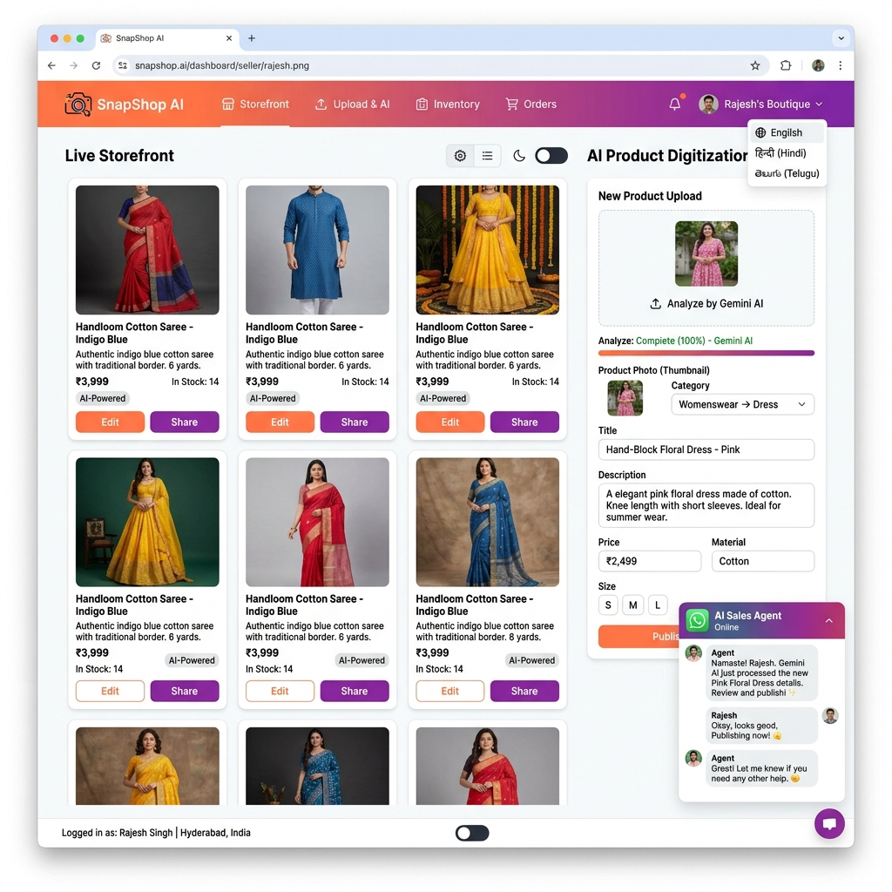

<div align="center">

# Koushik Portfolio

**Personal portfolio showcasing AI engineering, software projects, experience, and community work.**

[](https://nextjs.org/)
[](https://www.typescriptlang.org/)
[](https://react.dev/)

[Overview](#overview) · [Quick start](#quick-start) · [Structure](#project-structure) · [Configuration](#customization)

</div>



## Overview

A responsive, animation-rich portfolio for **Banuri Koushik Reddy**, built with the Next.js App Router. The site brings together an introduction, technical skills, projects, open-source/community activity, work experience, certifications, and contact details.

### Highlights

- Dynamic project listing and individual project-detail routes.
- Experience, skills, certifications, contributions, and community sections.
- Motion effects powered by **GSAP**, smooth scrolling with **Lenis**, and custom navigation.
- Responsive UI with **Tailwind CSS**, reusable React components, and Lucide icons.
- Search-engine metadata and sitemap support through Next.js.

## Quick start

**Requirements:** Node.js and a compatible package manager (the repository includes a pnpm lockfile).

```bash
git clone https://github.com/KOUSHIK1831/Koushik-Portfolio.git
cd Koushik-Portfolio
pnpm install
pnpm dev
```

Open [http://localhost:3000](http://localhost:3000). To create and serve a production build:

```bash
pnpm build
pnpm start
```

> [!NOTE]
> The repository currently defines a `lint` script using `next lint`, which is not supported by some newer Next.js configurations. If linting fails, check the installed Next.js version and run ESLint directly after configuring it for your environment.

## Tech stack

| Area | Tools |
| --- | --- |
| Framework | Next.js 15, React, TypeScript |
| Styling | Tailwind CSS, custom CSS |
| Animation | GSAP, Lenis |
| UI assets | Lucide icons, project thumbnails and illustrations |
| Tooling | pnpm, ESLint, TypeScript |

## Project structure

```text
app/
  page.tsx              Landing page composition
  layout.tsx            Root layout, metadata, navigation
  _components/          Homepage sections
  projects/[slug]/      Individual project pages
  contributions/[slug]/ Contribution details
components/             Shared visual and navigation components
lib/data.ts             Profile, skills, projects, experience
public/                 Project images and static assets
```

## Page structure and content flow

The homepage in [`app/page.tsx`](app/page.tsx) composes sections for the
introduction, about information, skills, projects, community work,
experience, certifications, and contact information. Shared navigation,
footer, smooth scrolling, preloader, cursor, and visual effects are
configured in [`app/layout.tsx`](app/layout.tsx).

Individual project pages live under `app/projects/[slug]/`, while
community contribution pages live under `app/contributions/[slug]/`.
Both use route parameters built from data in `lib/data.ts` and return
Next.js's not-found page for unknown entries.

## Adding a project

1. Add a project record in the `PROJECTS` array in
   [`lib/data.ts`](lib/data.ts), following the existing object shape.
2. Give it a unique `slug`; that slug determines its detail-page URL.
3. Add images to `public/projects/` and use matching public paths in
   the project record.
4. Include a meaningful project description, its actual technologies,
   and working source/demo links when available.
5. Run `pnpm build` to check route generation and metadata.

For community contributions, update the corresponding records in
`COMMUNITY_CONTRIBUTIONS`. Their detail routes are generated
separately from the project pages.

## Deployment checklist

- Set the correct site URL in [`app/sitemap.ts`](app/sitemap.ts);
  the file currently contains a placeholder comment.
- Verify the profile links and contact information in `GENERAL_INFO`.
- Confirm each project's images and external links work.
- Run a production build before deploying to a compatible Next.js host.
- Review metadata in `app/layout.tsx` and the dynamic project pages.

> [!NOTE]
> The checked-in source is the reference for supported pages and
> animations. A hosted URL or its availability should be verified
> independently before describing it as a live deployment.

## Customization

Most portfolio content lives in [`lib/data.ts`](lib/data.ts). Update `GENERAL_INFO`, `PROJECTS`, skill listings, experience, and contact details there. Adjust layout sections in `app/_components/` and design styles in `app/globals.css`.

For deployment, use a hosting provider that supports the Next.js application build. Set up your project's domain and environment configuration in the hosting service.

> [!TIP]
> Replace personal details, social links, and project screenshots before using this repository for a different portfolio. Keep attribution for third-party assets and design work as required.
